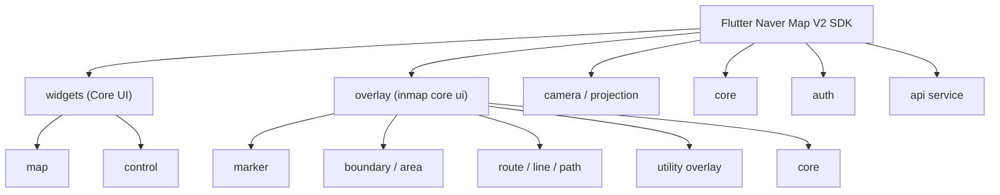
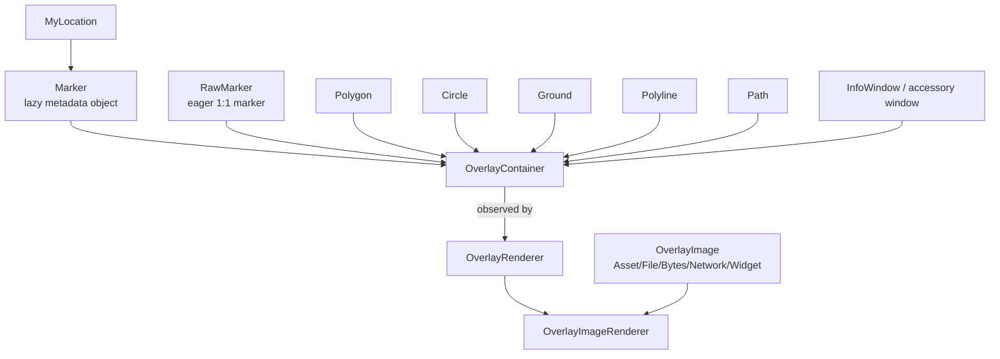
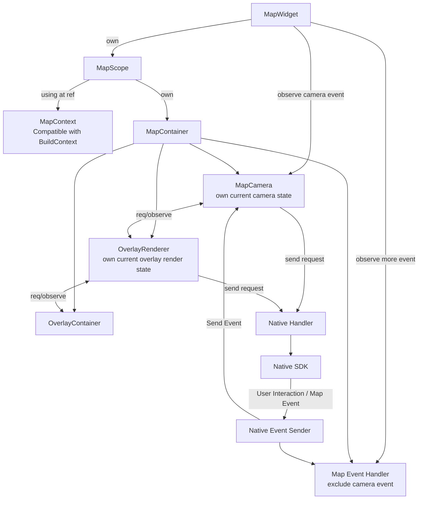

# Flutter Naver Map V2 SDK (WIP)

설계에 참고한 API
- NaverMap SDK
- Apple Mapkit
- Mapbox Maps
- Google Maps
- TMap API

- Jetpack Compose UI (DSL, Composable, Modifier...)


### todo + 구현 고려사항
- global state management (auth-sdk 인증상태라던지, poi라던지. 스타일 설정이라던지. 개별로도 가능하겠지만 전역으로 보여줄 수 있는 것들도 포함-아마 InheritedWidget 사용해도 괜찮을 듯. 캐시할 수 있는 것들도 포함...)
- poi
- 위젯에서 Map에 얹을 수 있는 영역 제공 (TopStack)
- 두개 이상의 맵에서 상태를 공유하는 usecase 찾기
- 타 지도 호환성 고려 (GoogleMap, AppleMap...  on Flutter)
- NMapOverlay.openInfoWidget() 을 통해 InfoWindow 대체
- keep center position when map content padding changed
- 커서/페이징 사용하여 lazy request하기 더 쉽게
- message(event) queue
- 낮은 줌 레벨 빌드 전략
- 내부적으로 MapUiContent 저장 전략 (s2)
- 글자/dynamic contents on overlay (글자면 여러 속성을 지원하게 native를 줘도?, 네이티브 구현을 보고 infowindow가 이미지로 빌드되면 이미지로 해결할 것)
- 컴퓨터 그래픽스적으로 바라보고 해결하기. (특히 3D Camera)
- Google S2 사용할 것. (flutter wrapper나 dart 순수 구현체 오픈소스로 있다면 고려해볼만함. 기본 동작에선 오버헤드 있을 수 있으므로, 1000개 이상의 오버레이가 있을때만 동작하는 것도 고려해볼만함. 우버 H3보단 S2가 더 비용이 적고 우리의 목적에는 S2가 더 알맞음.)

## 1. API Design

### API Design Objectives(Principles)
- 사용시 플러터와 최대한 유사한 DX를 제공한다.
- 사용법이 직관적이어야 한다. (Layer를 사용하면, 같은 z-index를 갖는 것처럼)
- 복잡성은 기본적으로 드러나지 않는다. 유연한 사용을 원하는 개발자에게만 드러나야 한다.
- 예측 가능성을 높여, 개발자의 의도와 다르게 작동할 가능성을 최소한으로 낮춰야 한다.
- 보일러플레이트 코드가 있다면, 그것을 직접 작성하게끔하는 이유가 명확해야 한다.
- 제약이 존재한다면(ex. dynamic flutter widget은 마커로 사용할 수 없는 제약), 그 제약은 최대한 물리적으로 드러나야 한다.

- *주로 지도 UI는 코드가 자주 변경되지 않는다. 따라서, 첫 작성시 사용법을 빠르게 파악할 수 있으며, 실수하지 않고 작성하게끔 하는 것이 중요하다.

Detail Concept
- Everything is NMapUiContent (like Flutter's Widget)
- Event Observing using InheritedWidget.

### Examples

Ex1
```dart
ComplexNaverMapWidget(
  uiOptions: options,
  buildStrategy: NMapBuildStrategy(
    overlayStrategy: NMapBuildOverlayStrategy(
      buildOnlyDisplayed: true,
    ),
  ),
  topLayer: ControlUiLayer(),
  contentsBuilder: (NMapUiContext context) {
  // contents builder diff calc must finished in 33ms (30fps)
    return [ // type: List<NMapUiContent>
      RoutePathLayer(),
      NMapPoiLayer(), // symbols
      MyPoiLayer(),
      MyMarkerLayer(),
    ];
  }
)

// ----

class RoutePathLayer extends NMapUiContentLayer {
  @override
  List<NaverMapUiElement> build(NMapUiContext context) {
    // riverpod example
    final pathData = (context as Ref).watch(pathProvider);
    return pathData.entries.map(_friendRoutePath).toList();
  }
  
  NMapPath _friendRoutePath(PersonPathInfo info) {
    return NMapPath(
      id: info.friendId,
      coords: info.path,
      color: info.color,
    );
  }
}

class MyPoiLayer extends NMapUiContentLayer {
  @override
  List<NaverMapUiElement> build(NMapUiContext context) {
    final pois = (context as Ref).watch(poiProvider);
    return NMapPoiToMarkerBuilder(
      pois: pois,
      // builder: (List<NMapPoi> currentMapPoi) {
        // 1:1 example
        // return currentMapPoi.map(_fromPoiMarker).toList();
      // },
      
      // ClusteredKey is set Google S2 Cell Id by default.
      // if you want, it customizable.
      clusteredBuilder: 
        (Map<ClusteredKey, List<NMapPoi>> currentMapPoi) {
          return currentMapPoi.map((key, poiSet) => 
            _buildClusterSet(poiSet)).toList();
      }
    );
  }  
  
  NMapMarker _fromPoiMarker(NMapPoi poi) {
    return NMapMarker(
      id: poi.id,
      position: poi.coord,
      caption: NMapCaption(text: poi.info.placeName),
    );
  }
  
  NMapMarker _buildClusterSet(List<NMapPoi> pois) {
    final firstPoi = pois.firstOrNull;
    assert(firstPoi != null);
    final center = NLatLngBounds.fromLatLngs(
        pois.map((poi) => poi.coord).toList()).center;
    final count = poi.length;
    return NMapMarker(
      id: "clustered_${firstPoi.id}",
      position: center,
      caption: NMapCaption(text: count.toString()),
      captionAlign: .center,
    );
  }
}
```

Ex2
```dart
// Camera 활용 예제 포함
class ControlUiLayer extends WidgetNMapUiContent {
  @override
  Widget build(NMapUiContext context) {
    return NMapUiStack(
      autoMapContentPadding: true, // 지도의 활성 컨텐츠 영역을 제한할 수 있는 mapContentPadding을 자동으로 조절하여 top, bottom 영역을 제외한 영역으로 활성영역을 자동으로 조절합니다.
      top: _searchBarButton(),
      right: Column(
        children: [
          NMapUiCompass(undisplayWhenNotRotated: true),
          Row(
            spacing: 8,
            children: [
              NMapUiScaleBar(),
              NMapUiMyLocationButton(),
            ],
          ),
        ],
      ),
      // 고민중.
//      bottom: NMapUiBottomDrawer(
//        body: Container(
//          
//        ),
//      ),
    );
  }
}
```


## 2. Api 디자인 메모들


### 오버레이 공통 옵션들 (Mobile)

Z index
- int zIndex
- int _globalZIndex
디스플레이 여부
- bool isVisible
줌
- visibleZoomRange (inclusive 가능)
클릭
- setOnTapListener
- Future<void> performClick()


### 마커요소 (Mobile)
- String id (aka “Key”)
- LatLng position
- decorate
    - OverlayImage icon
        - iconTintColor (가산혼합)
        - perspective (3D시 원근)
    - size
    - anchor
    - alpha
    - angle
    - flat (3D시 바닥에 붙을지 여부)
    - caption
        - mainCaptionInfo: text, size, color, haloColor, visibleZoomRange(nonInclusive), maxWidth(개행 너비)
        - subCaptionInfo
        - align (위젯기준, fallback 지정 가능)
        - offset
        - perspective (3D시 원근)
- 겹침처리 (CollidStrategy)
    - isHideCollidedCaptions: 겹칠경우 다른마커 캡션을 숨길지 여부
    - isHideCollidedMarkers: 겹칠경우 다른 마커를 숨길지 여부
    - isHideCollidedSymbols: 겹칠경우 심볼을 숨길지 여부
    - isForceShowCaption: 겹칠경우 무조건 캡션을 보여줄지 여부
    - bool isForceShowIcon: 겹칠경우 무조건 아이콘을 보여줄지 여부


### 마커 관련 메모
현재 기본 사이즈는 imageSize/devicePixelRatio
ex. 72x72라면, 3배수 디바이스에서는 24dp로 / 2배수에선 36dp로 보여짐. (플러터의 동작과는 다름)


마커의 종류를 같게
- 특정 타입의 마커를 한번에 제어하는 방법 
    - 레이어 내의 마커를 MinimalBuild하는 아이디어 (BuildScope를 줄이는 방식)
    - id를 정규식으로 찾기
    - poi에 type을 지정할 수 있게 만들기
    - 커스텀 마커(커스텀 오버레이)로 분리되도록


마커 != poi
poi 타입을 따로 넣을 수 있게 만든다면?
→ 마커로 바꿔주는 전략을 직접 Builder로 만들 수 있게 하기 (Overlay Function(poi) builder)
→ 이걸 여러 개에 대응 가능하게 한다면 사실상 클러스터링.


겹침을 설계적으로 방어할지? → 근처 마커 정보를 불러오거나 / 정말 엄격한 클러스터링
- 일정 퍼센티지 이상/거리기준? width가 겹칠 경우
- 거의 완벽하게 겹칠 경우
- 혹은 S2 Cell의 높은 레벨을 기준으로?


사용되는 순위를 보면

1. marker (사실상 커스텀 poi)
2. path (길)
3. polygon (영역을 표시할 경우)
4. circle (반경 표시할 경우)


Marker의 유즈케이스
- poi display
- 특정 위치 선택 (탭하거나, 지도를 움직여 선택)
- 개체 (택시 이동중인 경우→ Dynamic / 타다 / 카카오맵실시간버스지하철)
- 텍스트 표시 (주석) → NMapAnnotateOverlay


### 오버레이 외에도 전체 메모


전역 설정? 필요할까?: 그렇게 지도를 자주 쓰지 않음


Dynamic Map SDK의 유즈케이스
- **poi display**
    - 부동산
    - 공유교통수단(킥보드/전기차충전소) 앱 (교통수단 위치 표출)
    - 부동산 앱 (매물 정보 표시/클러스터링 예시/지역 구분 폴리곤 표시)
       - → (Poi) => Marker/Path/Polygon

- **dynamic poi(entity) display**
    - 택시/배달 앱 (경로 표시 및 실시간 위치 공유)
    - 러닝 앱 (다중 구간 경로 표시/실시간 유저 위치 공유)
       - → 매 업데이트 쿼리를 수행하면 됨. (minimal build를 통해 퍼포먼스 개선 가능.)

- 날씨 앱 (레이더/지역별 날씨 표시)
- 네비앱 (도로실시간교통상황, 3D Map)
- 관제


#### 지도 전체 옵션들

지도 보여주는 속성
- initialCameraPosition
- mapType
- liteModeEnable
- nightModeEnable
- indoorEnable
- activeLayerGroups
- buildingHeight
- lightness (?)
- locale

UI 속성 --------------
- contentPadding
*심벌
- symbolScale
- symbolPerspectiveRatio (원근)
*여기는 TopLayer에 그룹으로 갈음 가능.
- locationButtonEnable → 별도 내 위치 버튼 제공
- logoClickEnable → 로고 위젯 제공 (옵션)
- logoAlign → 로고 위젯 제공 (상위 레이어에서 알아서 배치)
- logoMargin → 로고 위젯 제공
- scaleBarEnable → ScaleBar 위젯 제공
- indoorLevelPickerEnable → ...이거는 정보가 너무 부족해서 따로 뺄 수 있을지 의문.

지도 인터렉션 옵션 (제약) --------------
- minZoom
- maxZoom
- maxTilt
- extent (움직일 수 있는 범위)
*제스처
- scrollGesturesEnable
- zoomGesturesEnable
- rotationGesturesEnable
- tiltGesturesEnable
- stopGesturesEnable
- scrollGesturesFriction
- zoomGesturesFriction
- rotationGesturesFriction
*탭
- consumeSymbolTapEvents
- indoorFocusRadius (실내지도 활성화 시작 반경)
- pickTolerance (터치반경, pickable)


#### 지도 남길 속성들

- initialCameraPosition

지도 보여주는 속성
- mapType
- liteModeEnable
- nightModeEnable
- indoorEnable
- activeLayerGroups
- buildingHeight
- lightness
- locale
- contentPadding
*심벌
- symbolScale
- symbolPerspectiveRatio (원근)
*custom style
- styleId
지도 인터렉션 옵션 (interaction / restrict) --------------
- zoomRange (inclusive only)
- maxTilt
- extent (움직일 수 있는 범위)
*제스처
- scrollGesturesEnable
- zoomGesturesEnable
- rotationGesturesEnable
- tiltGesturesEnable
- stopGesturesEnable
- scrollGesturesFriction
- zoomGesturesFriction
- rotationGesturesFriction
*탭
- consumeSymbolTapEvents
- indoorFocusRadius (실내지도 활성화 시작 반경) → indoorEnable이랑 묶어야 할까?
- pickTolerance (터치반경, pickable)


#### 3rd-party 호환 레이어 관련
- 대부분 Google Map 구조
- 주의해야할 점은 세부적으로 렌더링사이클을 직접 관리할 수 없다는 점

- 최종 호환 레이어는 Google Map 형태 + NMap v2 구조 두개 모두 제공? 그렇다면 기본적으로는 API FFI 계층이후에 새로 우리가 구현하는게 나을수도.


---

## 3. Structure

### SDK 범위

상단 구조는 `Flutter Naver Map V2 SDK (WIP)`로 정의되어 있다.

### 모듈 구성



## 4. Widgets

`widgets (Core UI)`는 지도 위젯과 지도 컨트롤 위젯으로 나뉜다.

### map

- `complex map widget`: 다용도 / dynamic
- `oneshot map widget`: 주로 한 번만 띄우는 경우 / 선언형

### control

- `ZoomStepper`: 현재 줌 레벨 제어
- `ScaleBar`: 현재 줌 레벨에 따른 지도의 축척 표시
- `Compass`: 현재 bearing 표시 및 제어
- `MyLocationButton`: 현재 위치를 지도상에서 보여줄지 여부와 카메라를 같이 움직일지를 제어
- `IndoorFloorController`: 실내 지도의 층을 제어하는 컨트롤러
- `LogoButton`: 법률정보, 오픈소스 라이선스, 범례 정보를 보여줌

## 5. Overlay

### marker

- `Marker`
  - Primary lazy marker.
  - 전략에 따른 표시 여부 제어.
  - 메타데이터 기반 경량 객체.
- `RawMarker`
  - eager marker.
  - 실제 렌더링 마커와 1:1 대응이 필요할 경우에만 사용.
- `MarkerStyler`
  - 마커의 변경 가능한 스타일을 제어.
  - `StyleTag` 기반 사용 가능.
- `MarkerVisibilityStrategy`
  - Marker 표시 전략 지정.
  - `DefaultMarkerStrategy`, `ClusteringMarkerStrategy` 기본 제공.

설계 코멘트:

- Marker 스타일을 동적으로 변경해야 하는 경우, 예를 들어 유저 인터랙션이 있는 경우, 다른 style tag를 가진 Marker를 하나 더 삽입해 overwrite하는 방식을 고려한다.
- 이때 event send priority를 자동으로 올릴 수 있도록 제공할지 검토한다.
- 스타일을 외부 API에 노출할지, 내부적으로 처리할지 검토가 필요하다.
- 불편하지 않다면 변환 로직이 줄어들기 때문에 노출을 선호한다.

### boundary / area

- `Polygon`: 특정 영역을 다각형으로 표시
- `Circle`: 특정 반경을 표시
- `Ground`: 특정 직사각형 영역을 이미지로 표시

설계 코멘트:

- `Circle`과 `Ground`는 내부 구현에 `Marker`를 사용할 수 있다.
- 실제 사용할지는 아직 미정.
- `Ground`는 Marker에 추가 기능을 제공해 대체할 가능성이 있다.

### route / line / path

- `Polyline`: 일련의 좌표들을 선으로 표시
- `Path`: 일련의 좌표들을 경로로 표시

설계 코멘트:

- `Path`가 `Polyline`의 확장이므로 둘 중 하나만 남길지 고민 중.
- Polyline 용례를 더 살펴봐야 한다.
- 하나만 남긴다면 일부 옵션만 사용할 때 내부적으로 polyline을 사용해 비용을 자동으로 절감한다.
- Web에는 `Polyline`만 존재하므로, `Path`를 내부적으로만 사용할지도 검토 대상이다.

### utility overlay

- `MyLocation`: 나, 즉 사용자의 현재 위치 표시
- `InfoWindow`: 마커나 좌표 위에 표시되는 간단한 말풍선

설계 코멘트:

- `MyLocation`은 내부적으로 `Marker`를 사용할 예정. Web compatibility 목적.
- `InfoWindow`는 실제 SDK 오버레이가 아니라 지도 위 Stack 영역에 위치하는 Widget일 가능성이 높다.
- `InfoWindow` 이름을 `accessory window`로 변경할지 고민 중.

### overlay core

- `OverlayImage`
  - 이미지 소스.
  - 지원 메서드: `Asset`, `File`, `Bytes`, `Network`, `Widget`.
  - 지원 포맷: `jpg`, `png`, `webp`, `svg`.
  - preload feature 포함.
- `OverlayContainer`
  - 오버레이를 저장하는 객체.
  - `OverlayRenderer`와 협력한다.
  - observed.
  - `OverlayContainer(context)`로 접근.
- `OverlayRenderer`
  - 오버레이 렌더링 제어 객체.
  - lazy / eager.
- `OverlayImageRenderer`
  - 오버레이 이미지 렌더링 제어 객체.



## 6. Camera / Projection

- `MapCameraPosition`
  - 어디를 얼마나 보여줄지에 대한 시점 데이터.
- `MapCameraUpdate`
  - 카메라 이동에 대한 데이터.
  - `ViewPoint`, animation, 상대적 움직임 등을 포함.
- `MapCamera`
  - `.update`, `.cancelUpdate` 등을 통해 지도 시점을 제어.
  - 현재 상태 저장.
  - 카메라 이벤트 통지.
  - `MapCamera(context)`로 접근.

## 7. Core

- `MapContext`
  - 개발자가 각종 서비스 요소, 예를 들어 `camera`, `overlayContainer`에 접근하는 객체.
  - `onMapReady` 따위의 event에서 제공.
- `PointConverter`
  - 지도의 좌표와 화면의 좌표를 변환할 수 있는 객체.
  - `PositionConverter()`로 생성해 사용.
- `MapContainer`
  - 실제 map 서비스 요소들과 상태를 가지고 있는 객체.
  - `MapScope` 내에서 `MapContext`로 접근.
- `Map Event Delegator`
  - 카메라 이벤트를 제외한 지도 이벤트를 받아 Widget으로 전송.

## 8. Auth / API Service

- `MapAuthenticator`
- `NaverMapAuthenticator`
  - `ncp client id`
- `api service`
  - 추후 PoC 이후 진행 예정.

## 9. 데이터 흐름

보드의 `데이터 흐름`은 `Add Overlay`와 `Update Camera` 두 케이스를 분리한다.

### Add Overlay

- `OverlayContainer.add()`
  - Internally saved.
  - Event notify.
- `OverlayRenderer (lazy)`
  - request get current boundary to mapCamera.
  - request render overlay.
- `MapCamera.currentCameraPosition`
- `Native SDK`

```mermaid
flowchart TB
  Add["OverlayContainer.add()\nInternally saved\nEvent notify"]
  Renderer["OverlayRenderer (lazy)\nrequest get current boundary to mapCamera\nrequest render overlay"]
  Camera["MapCamera.currentCameraPosition"]
  Native["Native SDK"]

  Add -->|EventNotified (Added)| Renderer
  Renderer -->|req| Camera
  Renderer -->|request render overlay| Native
```

### Update Camera

- `MapCamera.update()`
  - Native send event notify.
  - Emitting before finished.
- `OverlayRenderer`
  - calculate render diff.
  - request render overlay.
- `Native SDK`

```mermaid
flowchart TB
  Update["MapCamera.update()\nNative send event notify\n(Emitting before finished)"]
  Renderer["OverlayRenderer\ncalculate render diff\nrequest render overlay"]
  Native["Native SDK"]

  Update -->|EventNotified (CameraUpdated)| Renderer
  Update -->|Request Camera Update| Native
  Renderer -->|request render overlay| Native
```

## 10. 객체 의존 관계

LLM-readable 파일의 그래프 기준 객체 관계는 다음과 같다.



해석:

- `MapWidget`은 `MapScope`를 소유한다.
- `MapScope`는 `MapContext`를 ref처럼 사용하고, `MapContainer`를 소유한다.
- `MapContainer`는 이벤트 핸들러, 카메라, 오버레이 렌더러, 오버레이 컨테이너의 중심 소유자다.
- camera event와 non-camera map event는 분리한다.
- native 요청은 `NativeHandler`로 내려가고, native 이벤트는 `NativeEventSender`로 올라온다.
